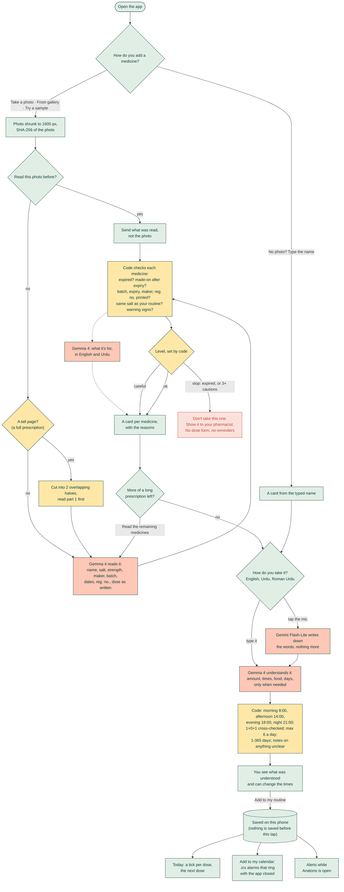
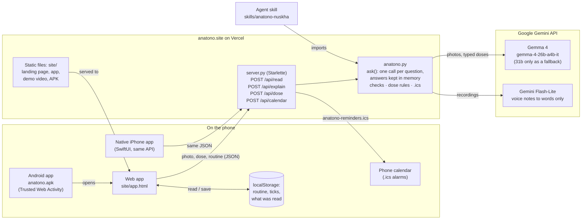

# Anatono

**Never miss a dose again.** Snap a medicine strip, a box or a whole handwritten prescription. Say or type how you
take it, in English, Urdu or Roman Urdu. Anatono turns it into reminders, and checks every medicine for warning signs
before you take it. Made for elders and the people who look after them.

Made by **Taseen Tariq** at Hack Day Faisalabad, 23 October 2026.

**Try it:** [anatono.site](https://anatono.site) (landing page) · [anatono.site/app.html](https://anatono.site/app.html)
(the app) · [Android app (APK)](https://anatono.site/anatono.apk)

[](https://anatono.site/demo.mp4)

**▶ [Watch the 30-second demo](https://anatono.site/demo.mp4)**: a real run of the app (Gemma 4's waits shown sped up), with captions.

> **Verify in 30 seconds**
> | | |
> |---|---|
> | **Model** | **Gemma 4** (`gemma-4-26b-a4b-it`; `gemma-4-31b-it` only as a fallback) through the **Gemini API** (`google-genai`). Licence: [Apache 2.0](https://ai.google.dev/gemma/apache_2). [`anatono.py` line 24](anatono.py#L24) |
> | **Where Gemma is called** | `ask()` in [`anatono.py` line 69](anatono.py#L69) → `ask_gemma()` ([line 85](anatono.py#L85)). It reads every photo (`read_photo`) and understands every dose (`understand_dose`) |
> | **Voice** | `gemini-3.5-flash-lite` **only writes down what was said** ([line 28](anatono.py#L28)), because Gemma 4 on the API doesn't take audio. Gemma 4 does all the understanding. |
> | **Harness** | Plain-code checks after every answer: expiry, impossible dates, missing batch / registration number, same ingredient twice, prescription shorthand (`1+0+1`, `BD`, `TDS`) cross-checked against Gemma's times, max 6 a day, 1–365 days. `python3 anatono.py` runs the self-check. |
> | **Agent skill** | [`skills/anatono-nuskha/SKILL.md`](skills/anatono-nuskha/SKILL.md) + script (`agentskills validate` → valid) |
> | **Licence** | MIT ([LICENSE](LICENSE)) |
> | **Key dependencies** | `google-genai`, `starlette`, `uvicorn`, `pillow`, `python-dotenv` ([requirements.txt](requirements.txt)); in the browser: Lucide icons (ISC), GSAP (free licence), Simple Icons (CC0), EB Garamond and Figtree (OFL) |

## How it works

1. **Read.** Gemma 4 reads the name, salt, strength, maker, batch, dates and registration number off a pack, or every
   line of a handwritten prescription, plus what each medicine is for in English and Urdu.
2. **Check.** Code, not the model, decides `ok` / `careful` / `stop`. An expired medicine gets no reminders.
3. **Understand the dose.** Typed or spoken, in any mix of languages. Code maps it to clock times (morning 8:00,
   afternoon 2:00, evening 6:00, night 9:00) and flags anything unclear.
4. **Confirm and remind.** Nothing is saved until the person taps "Add to my routine". Reminders show in the app and go
   into the phone's own calendar, so they ring even when the app is closed.

### The complete flow

Colours show where each step runs: **on the phone**, **plain code on the server** (`anatono.py`), or **a Google
model**. The model only reads and understands; code makes every decision.



### Read once, not twice

A prescription that was already read isn't sent to the model again. The phone keeps what was read (keyed by a SHA-256
of the photo and the part), and the server keeps every answer in memory too. On a repeat, only the code
checks run again, because they depend on today's date and on what's already in the routine. Typed doses and the
"what is it for" lines are kept the same way.

## Architecture



- **The phone keeps everything personal.** The routine, the ticks and what was read live in the browser's
  `localStorage`; there is no account and no database.
- **The server holds the key and the rules.** `GEMINI_API_KEY` is a Vercel environment variable, so the browser never
  sees it. `server.py` is a thin layer of four routes; `anatono.py` has the prompts, the model calls, the code checks,
  the dose rules and the calendar file.
- **The model reads, the code decides.** Gemma 4 turns a photo or a sentence into JSON. `check_medicine()` and
  `check_dose()` in plain Python decide `ok` / `careful` / `stop` and the exact reminder times, so a wrong guess by the
  model can't quietly become a wrong dose.
- **The agent skill** runs the same pipeline from the command line (photo in, checks and `.ics` out), no server needed.

## Run it

```bash
pip install -r requirements.txt
echo "GEMINI_API_KEY=your-key-from-aistudio.google.com" > .env
python3 server.py            # http://localhost:8600 (landing page) and http://localhost:8600/app.html (the app)
python3 anatono.py           # self-check of the code checks and the cache (no API call)
```

In the app, **Try a sample** loads [`site/samples/prescription.jpg`](site/samples/prescription.jpg), a made-up
prescription (no real doctor or patient).

On the live site, the key is a Vercel environment variable (`GEMINI_API_KEY`).

## Android app

[`anatono.apk`](https://anatono.site/anatono.apk) is a Trusted Web Activity made with
[Bubblewrap](https://github.com/GoogleChromeLabs/bubblewrap): the real app at anatono.site/app.html, full screen,
with its own icon. [`site/.well-known/assetlinks.json`](site/.well-known/assetlinks.json) proves the app and the site
belong together, so Android shows no browser bar. On a phone: open the link, allow "install unknown apps" for the
browser, install. The web app can also be installed straight from Chrome (⋮ → Add to Home screen).

## Layout

| Path | What it is |
|---|---|
| `anatono.py` | Model calls (Gemma 4), the answer cache, the checks, the dose rules, the calendar file |
| `server.py` | Starlette server: `/api/read`, `/api/explain`, `/api/dose`, `/api/calendar`, and the site |
| `site/index.html` | The landing page, with the demo video |
| `site/app.html` | The app (phone first): photo, checks, dose, routine, reminders |
| `site/anatono.apk` | The Android app |
| `skills/anatono-nuskha/` | The agent skill |

## Limits, honestly

- A photo can't prove a medicine is genuine. Anatono shows **warning signs**, and says so.
- It helps people remember what their doctor prescribed. It isn't medical advice and never changes a dose.
- Photos are sent to Google's Gemini API to be read. The routine stays on the phone.
- Testimonials on the landing page are placeholders, marked SAMPLE.

## Author

Taseen Tariq · [github.com/taseen-t](https://github.com/taseen-t) · MIT licence
